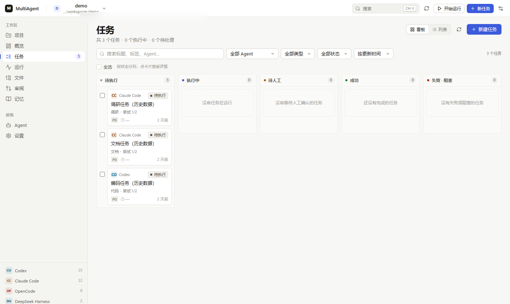
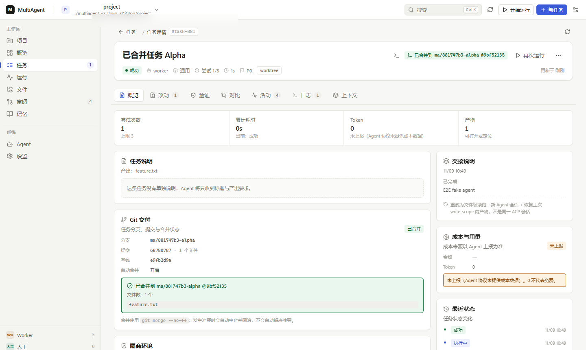
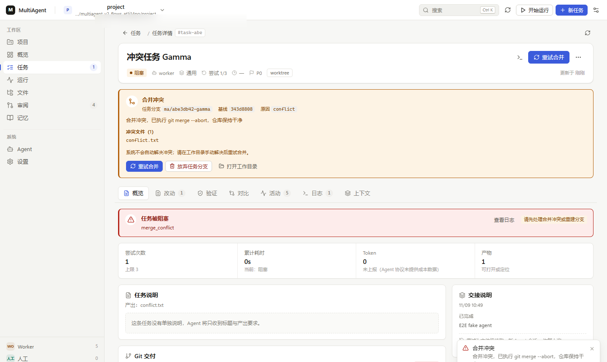
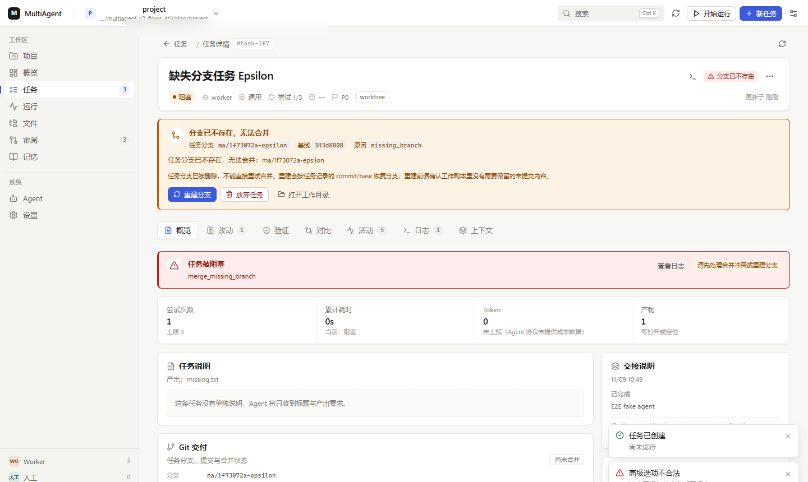
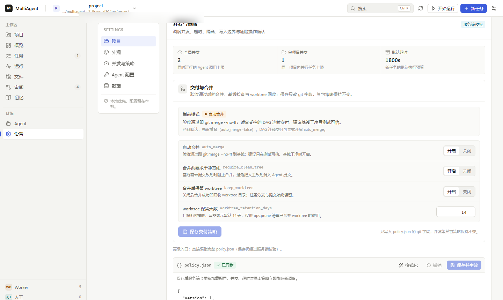
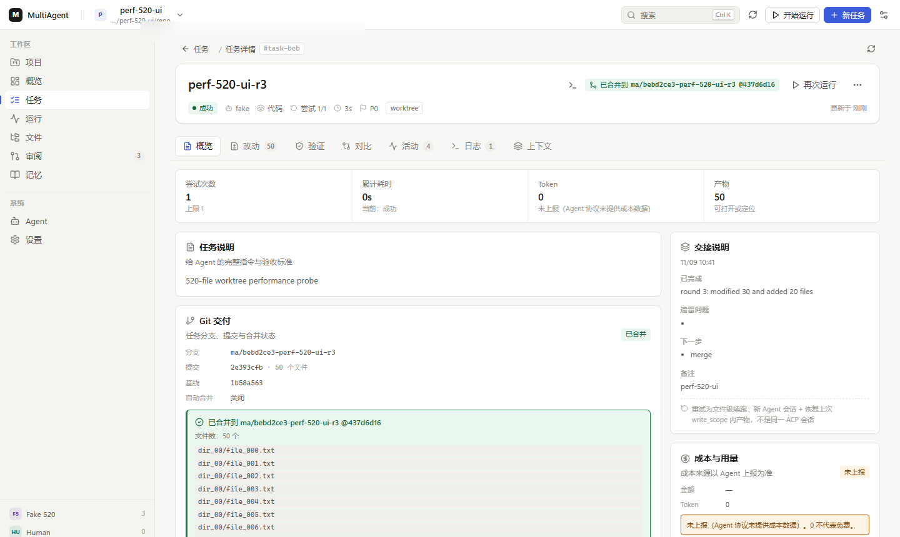
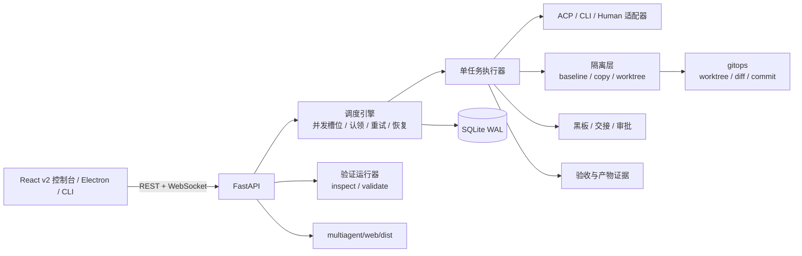

# MultiAgent 协作工作台

MultiAgent 是一个本地优先的多 Agent 编排工作台：把本机已安装的 Codex、Claude Code、
OpenCode、DeepSeek Harness 或任意 CLI Agent 组织成一支可调度的执行队伍，在同一个真实
项目目录上完成编码、文档、调研、数据整理、审阅等文件型工作。

它不内置大模型，也不替代 Agent 本身。核心职责是把目标拆成带依赖的任务 DAG，为每次
执行准备隔离工作副本或 Git worktree，以退出码、文件改动、验收条件和产物证据判定成败，
并把改动、日志、交接、审批和版本快照留在本机供人工审阅。

- 仓库地址：<https://github.com/xuanwoLQL/multiagent-workbench>
- v2.0.0 Release：<https://github.com/xuanwoLQL/multiagent-workbench/releases/tag/v2.0.0>
- 技术栈：Python 3.10+ / FastAPI / SQLite WAL / React 18 / Vite / Electron

## 截图

| 任务看板 | 已合并任务 |
| --- | --- |
|  |  |
|  |  |
|  |  |

截图来自 v2 真实浏览器 E2E 的最终运行，均为 1440×900；完整验证口径见
[docs/UI-FLOWS-REPORT.md](docs/UI-FLOWS-REPORT.md)。

## 核心能力

- **任务 DAG 与并发调度**：把目标拆成带依赖的任务，按全局/项目并发上限派发，支持原子认领、重试与恢复。
- **隔离执行**：Git 仓库优先使用 worktree，普通目录退化为 copy；用 `write_scope` 限制可回收路径。
- **证据化验收**：成功必须同时满足退出码、文件改动、验收条件、产物存在和认领凭证有效。
- **先审后合**：默认保留 `ma/<task>` 分支和提交，人工在控制台查看 diff 后再合并到基线。
- **多 Agent 接入**：支持 Codex、Claude Code、OpenCode、DeepSeek Harness 的 ACP/CLI 适配，也可人工执行。
- **本地数据面**：项目、任务、运行日志、黑板、审批与快照保存在本机 SQLite，不依赖托管服务。

## 快速开始

主要面向 Windows 10/11。Python 后端和浏览器控制台也可在其他平台运行，桌面打包脚本
目前以 Windows 为目标。

```powershell
git clone https://github.com/xuanwoLQL/multiagent-workbench.git
cd multiagent-workbench

python -m venv .venv
.\.venv\Scripts\python.exe -m pip install -r requirements.txt
.\.venv\Scripts\python.exe -m pip install -e ".[dev]"

.\.venv\Scripts\python.exe -m multiagent init
.\.venv\Scripts\python.exe -m multiagent doctor

cd webapp
npm ci
npm run build
cd ..

.\.venv\Scripts\python.exe scripts\serve.py --port 8770 --open
```

没有 Agent CLI 时仍可创建任务、浏览界面和运行测试，但无法真正执行任务。桌面壳可用
`cd desktop; npm ci; npm start` 启动。

## 验证数字

- Python 全量：**764 passed / 10 skipped / 0 failed**。
- 控制台冒烟：**67/67**。
- 真实浏览器 E2E：**8/8 flows、182/182 checks**，0 uncaught、0 console error；1 条预期 409 network warning。
- 发布包验证：`verify_package.ps1` 连续 **3/3** 次 `exitCode=0`，无后端/Electron 残留。
- 520 文件性能中位数：prepare worktree **1.327s**、run **3.196s**、merge **0.678s**；UI 页面加载 **1.046s**、任务详情 **1.691s**。

详细证据与边界见 [docs/PACKAGE-VERIFICATION.md](docs/PACKAGE-VERIFICATION.md)、
[docs/UI-FLOWS-REPORT.md](docs/UI-FLOWS-REPORT.md) 和 [docs/DEFECTS-V2.md](docs/DEFECTS-V2.md)。

## 架构简述

```text
React v2 控制台 / Electron / CLI
            │ REST + WebSocket
            ▼
         FastAPI API
            │
            ▼
     调度引擎 / 单任务 Runner
       │      │       │
       │      │       └── 验收与产物证据
       │      └────────── ACP / CLI / Human 适配器
       └───────────────── baseline / copy / worktree 隔离 + Git 操作
            │
            ▼
       SQLite WAL（项目、任务、运行、黑板、审批、快照）
```

## 适用对象

适合：

- 已经在本机使用 Codex / Claude Code / OpenCode / DSH 的开发者；
- 想让多个 Agent 在真实仓库里分工，但不想让它们直接改工作区的人；
- 需要保留每次调用的 Prompt、stdout/stderr、diff、验收结果和审批记录的小团队；
- 需要在无 Git 的普通目录上运行，也需要在 Git 仓库里用 worktree 隔离的人。

不适合：

- 把它当作托管 SaaS、模型服务或多人权限系统；
- 把它当作安全沙箱。它限制路径和写入范围，但不提供 VM / 容器级隔离；
- 期望无人值守地自动合并所有 Agent 改动。

## 安装

主要面向 Windows 10/11；Python 后端和浏览器控制台可以在其他平台运行，桌面打包脚本
目前以 Windows 为目标。

前置条件：

- Python 3.10+
- Node.js（仅构建 v2 前端时需要）
- Git（仅 worktree 隔离需要；普通目录会退化为 copy 隔离）
- 至少一个可用的 Agent CLI。没有 Agent 时仍可创建任务、浏览界面和跑测试，但无法真正执行。

```powershell
cd multiagent-workbench
python -m venv .venv
.\.venv\Scripts\python.exe -m pip install -r requirements.txt
.\.venv\Scripts\python.exe -m pip install -e ".[dev]"

# 生成 config/*.json 与 .multiagent/ 数据目录
.\.venv\Scripts\python.exe -m multiagent init

# 环境 / 配置 / Agent 握手自检
.\.venv\Scripts\python.exe -m multiagent doctor
```

Agent 的启动命令、角色和额度在 `config/agents.json` 中维护。修改后可在控制台
「设置 → Agent 配置」保存，或直接编辑 JSON。

## 运行

### 开发模式：后端 + Vite

终端 A 启动后端：

```powershell
.\.venv\Scripts\python.exe scripts\serve.py --port 8770
```

终端 B 启动前端开发服务器：

```powershell
cd webapp
npm install
npm run dev
```

打开 `http://127.0.0.1:5173/`。Vite 会把 `/api` 和 `/ws` 代理到 `127.0.0.1:8770`；
如果后端换了端口，需要同步修改 `webapp/vite.config.ts` 的代理目标。

### 构建 v2 前端并由后端提供

```powershell
cd webapp
npm run build
```

构建产物写入 `multiagent/web/dist/`。后端启动后：

- `/` 优先返回 v2 的 `dist/index.html`；
- `/static/` 提供 `multiagent/web/` 下的静态资源；
- 旧版零构建控制台默认不暴露：`/legacy` 和 `/static/index.html` 默认返回 404；
  只有设置 `MULTIAGENT_UI=legacy` 并重启后，`/legacy` 才可访问；
- 构建产物缺失时，`/` 会降级返回旧页面，这属于最小安装兜底，不是并列入口。

```powershell
.\.venv\Scripts\python.exe scripts\serve.py --port 8770 --open
```

### 桌面控制台

```powershell
cd desktop
npm install
npm start
```

也可以双击 `desktop\start.cmd`。桌面壳会自动选择空闲端口、拉起 Python 后端，
等待 `/api/health` 就绪后打开窗口；关闭窗口时结束后端进程树。

### 打包

```powershell
# 1) 冻结 Python 后端
.\.venv\Scripts\python.exe -m pip install pyinstaller
.\.venv\Scripts\python.exe scripts\build_backend.py

# 2) 打包 Electron
cd desktop
npm install
npm run dist           # NSIS 安装包 + portable
npm run dist:v2        # 输出到 desktop/release-v2
```

打包后的应用优先使用 `resources\backend\` 下的冻结后端，不再要求目标机器安装 Python。
产物清单与签名说明见 [docs/RELEASE.md](docs/RELEASE.md)。

安装包不纳入源码仓库。v2.0.0 的 NSIS 安装包与 portable 版本请从
[Release](https://github.com/xuanwoLQL/multiagent-workbench/releases/tag/v2.0.0)
下载；当前产物均**未签名**（NotSigned），首次运行可能触发 SmartScreen「未知发布者」，
请按 [docs/RELEASE.md](docs/RELEASE.md) 校验 SHA256 后再运行。

## 核心工作流

`项目 → 任务 → 运行 → 审阅 → 合并/同步`

1. **项目**：在欢迎页打开已有目录，或在「设置 → 项目」新建/导入工作区。项目登记只记录
   路径与元数据，不复制你的源目录。导入/新建按**规范化绝对路径**判重；同一目录重复登记
   返回 409，并在 `existing_project_id` 中给出已存在的项目。
2. **任务**：点「新任务」，用一句话描述目标，可选填产出文件、执行 Agent、任务类型、
   隔离方式和写范围。勾选「拆成『调研 → 初稿 → 审阅』三步」会创建带依赖的三段 DAG。
   批量计划创建前会扫描项目根目录：精确路径若按 basename 只有唯一候选，会自动回填到
   `outputs`/验收条件；多候选或无候选只告警，不阻断创建（glob 不重写）。
3. **运行**：点顶栏「开始运行」启动项目调度，或在任务详情里单独运行。引擎按
   `global / per_project` 并发上限派发，原子认领任务，准备隔离副本后调用 Agent。
4. **审阅**：任务产生文件改动后出现在「审阅」队列。逐文件查看统一 diff；失败、阻塞或
   等待人工的任务也会进入队列，但分组为「失败」。
5. **合并/同步**：worktree 任务验收通过后，Runner **只在 `ma/<task>` 分支提交**交付物
   （提交显式排除 `.multiagent/` 控制面）。默认 `policy.git.auto_merge=false`，即
   **先审后合**：任务分支和提交保留，不自动改动基线；需在任务详情/审阅页人工
   「合并到基线」后，下游任务才能看到上游产出。默认
   `git.require_merged_for_dependents=true` 会在前置任务未真正合并时阻止下游派发，
   合并后自动恢复 ready（仅约束默认 `success` 边）。只有需要 DAG 连续交付、且能接受
   自动落基线的项目，才显式设 `git.auto_merge=true`。
   - `policy.git.require_clean_tree`（默认开启）：基线工作树有未提交改动时**阻断合并**，
     不会把人工改动混进 Agent 提交；`.multiagent/` 不计入脏树。
   - 合并冲突时执行 `git merge --abort`，仓库保持干净；API 返回 409 +
     `conflict/files`，UI 显示冲突文件，需人工在工作目录解决后「重试合并」。
     系统不会自动解决冲突。
   - 「放弃任务分支」会删除 worktree，并可选删除 `ma/...` 分支；之后任务显示
     `discarded`，不再提供必然 409 的合并入口。
   - 非 Git / copy 模式仍使用文件级「同步」，只回收写范围内、未命中保护路径且无冲突
     的文件。
   - 「重试」是**文件级续跑**：恢复上次 `write_scope` 内的半成品到新工作副本，
     不是 ACP session resume，也不会延长正在运行的上次调用。

任务成功必须同时满足：Agent 退出成功、验收条件通过、声明的产物存在、没有并发冲突、
认领凭证仍然有效。任一条件不满足时不会自动覆盖工作区，现场保留在运行目录中。

每次运行的成本写入 `task.result.cost`，`source` 区分 `reported`（Agent/协议真实上报）、
`estimated`（本地估算，当前适配器未产生）和 `unreported`（协议未提供）。`unreported`
时金额 0 只表示未知，**不代表免费**。

### 关键策略（`config/policy.json`）

| 字段 | 默认 | 作用 |
| --- | --- | --- |
| `git.auto_merge` | `false` | 验收通过只在 `ma/<task>` 分支提交，默认不合并回基线（先审后合）；显式设为 `true` 才自动 `git merge --no-ff`（需要 DAG 连续交付） |
| `git.require_clean_tree` | `true` | 基线有未提交改动时阻断合并；`.multiagent/` 不计入脏树 |
| `git.require_merged_for_dependents` | `true` | 先审后合下，前置任务分支未真正合并时下游保持 pending；人工/自动合并后自动恢复 ready（仅约束默认 `success` 边） |
| `git.keep_worktree` | `true` | 合并成功后是否保留 worktree 目录；任务分支与提交永远保留 |
| `git.worktree_retention_days` | `14` | `maintenance` 清理已合并 worktree 的保留天数 |
| `processes.audit_enabled` | `true` | Agent 调用前后审计新增监听端口 |
| `processes.reap_orphans` | `true` | 只回收能证明属于本任务 workdir 的监听进程；判断不了只告警 |
| `processes.min_timeout_sec` | `0` | 默认所有任务都审计；设为正数可作为极短任务的逃生阀（0 表示不限时，仍审计） |
| `processes.cim_fallback` | `true` | Windows finish 阶段用 Get-NetTCPConnection 补齐 netstat 漏报；失败只降级 warning |

默认保持先审后合。需要 DAG 连续交付（下游任务必须立即看到上游产出）时，显式把
`auto_merge` 改为 `true`，建议同时保留脏树检查与 worktree 保留：

```json
{
  "git": {
    "auto_merge": true,
    "require_clean_tree": true,
    "require_merged_for_dependents": true,
    "keep_worktree": true
  }
}
```

`require_clean_tree=true` 防止人工未提交改动被混入合并；
`require_merged_for_dependents=true` 保证下游只在上游真正落基线后启动；
`keep_worktree=true` 保留工作副本便于复审。自动合并只适合基线干净、并行任务写范围
不重叠的流水线；否则仍会被脏树/冲突阻断。日常人工审阅应保持 `auto_merge=false`。

## Agent 支持矩阵

| 执行端 | 协议 | ACP 启动方式 | CLI 兜底 | 默认角色 |
| --- | --- | --- | --- | --- |
| Codex | ACP | `codex-acp` | `codex exec -`（stdin） | lead / implementer / verifier / reviser / reviewer |
| Claude Code | ACP | `claude-agent-acp` | `claude -p`（stdin） | lead / reviewer / verifier / writer / reviser |
| OpenCode | ACP | `opencode acp` | `opencode run`（arg） | lead / implementer / recon / worker |
| DeepSeek Harness | ACP | `dsh --profile acp` | 无 | implementer / summarizer / worker |
| 任意 CLI Agent | CLI | — | 在 `config/agents.json` 配置 `command` / `args` / `prompt_mode` | 由配置决定 |
| 人工执行者 | human | — | — | 人工接手、人工产出、人工验收 |

ACP 是首选协议，支持流式事件、权限请求和统一握手；CLI 适配器用于扩展没有 ACP 的
Agent。`multiagent agent check` 只做连通性/握手探测，不消耗模型额度。

模型由 Agent 自身配置决定：ACP v1 适配器不发送请求级 `model` 字段；CLI 适配器仅在
`config/agents.json` 的 `args` 中真的包含 `{model}` 占位符时才注入模型名。控制台的
Agent 卡片会按同一语义显示「模型由 Agent 自身配置决定 / CLI 参数注入 {model} / 未配置」，
不会把未生效的 `model` 字段显示成已生效。

## 架构



主要模块：

| 模块 | 职责 |
| --- | --- |
| `multiagent/api/` | REST + WebSocket、安全策略、文件/Git/验证路由、静态资源 |
| `multiagent/orchestrator/` | 调度、并发槽位、原子认领、单任务执行、重试/恢复/扇出 |
| `multiagent/workspace/` | 项目、快照、baseline、隔离副本、改动日志、冲突与回滚 |
| `multiagent/gitops/` | Git worktree、分支命名、diff 摘要、任务提交 |
| `multiagent/validation/` | 技术栈探测、检查命令生成、受限执行与报告 |
| `multiagent/tasks/` | 任务 DAG、状态机、验收条件、产物、类型模板 |
| `multiagent/board/` | 共享黑板、版本化记忆、交接说明、审批事件 |
| `multiagent/safety/` | 危险操作拦截、人工确认队列、Agent 额度 |
| `multiagent/agents/` | ACP / CLI / human 适配器、进程树回收、编码回退 |
| `webapp/` | v2 React 控制台（Vite + React Query + Zustand） |
| `desktop/` | Electron 外壳、后端拉起、打包配置 |

更细的 v2 前端模块、状态层、数据模型和失败分类见
[docs/V2-ARCHITECTURE.md](docs/V2-ARCHITECTURE.md)。

## 安全模型摘要

本机 API 能驱动 Agent 执行任意命令，因此「谁能调用它」是最大的真实风险面。

- **默认 loopback 零配置**：绑定 `127.0.0.1` 时不要求 token，但仍校验 `Host` 白名单
  和 `Origin` 同源，阻止 DNS rebinding 与跨站请求。
- **非 loopback / 严格模式**：绑定其他地址或设置 `MULTIAGENT_STRICT_AUTH=1` 时，
  `/api/**` 要求 `Authorization: Bearer <token>`；token 可来自 `--token`、
  `MULTIAGENT_API_TOKEN` 或 `<home>/.multiagent/token`（自动生成，权限 0600）。
- **WebSocket 鉴权**：浏览器新客户端用
  `Sec-WebSocket-Protocol: multiagent.token.<base64url(token)>` 传递 token，服务端在
  握手时回显该子协议；URL 不再携带 token。旧的 `?token=` 仍兼容，但会进入访问日志。
- **路径边界**：项目导入、`/api/fs/list`、配置文件读取、运行输出、diff blob 都做规范化
  与边界校验；符号链接逃逸会被拒绝。
- **写入边界**：`write_scope` 限定可回收路径；`read_only` 任务强制使用独立副本；
  `.multiagent`、`config`、`.git` 属于保护路径；`.multiagentignore` 与工作区 excludes
  永远不进入交付物。
- **危险操作**：删除、覆盖已有产物、修改项目配置等操作默认拦截并生成审批项，不会
  静默执行。
- **失败不自动合并**：取消、超时、并发冲突、工作区漂移、验收失败时只保留现场，
  由人工审阅后决定同步或回滚。
- **浏览器侧**：默认关闭 CORS；响应带 `nosniff`、`X-Frame-Options: DENY`、
  `Referrer-Policy: no-referrer` 和 `script-src 'self'` 的 CSP；React 默认转义文本。

细节与验证方式见 [docs/ARCHITECTURE.md](docs/ARCHITECTURE.md)、
[docs/VERIFICATION.md](docs/VERIFICATION.md)。

## CLI 速查

所有命令都支持 `--home <dir>` 与 `--json`。完整参数见
[docs/USAGE.md](docs/USAGE.md)；v2 控制台操作见 [docs/USAGE-V2.md](docs/USAGE-V2.md)。

```powershell
# 初始化 / 自检
python -m multiagent init
python -m multiagent doctor

# 项目
python -m multiagent project import D:\work\demo --name demo
python -m multiagent project list
python -m multiagent project show --project demo

# 任务
python -m multiagent task add --project demo --title "实现登录" --kind code `
  --outputs src/auth.ts --scope "src/**"
python -m multiagent task add-plan --project demo --file plan.json
python -m multiagent task run-project --project demo
python -m multiagent task status --project demo
python -m multiagent task show --task <task-id>
python -m multiagent task sync --task <task-id> --dry-run
python -m multiagent task approve --task <task-id> --sync
python -m multiagent task retry --task <task-id>

# 观测 / 运维
python -m multiagent stats --project demo
python -m multiagent runs --project demo
python -m multiagent timeline --project demo --out timeline.md
python -m multiagent storage
python -m multiagent backup --label before-upgrade
python -m multiagent verify --full

# Web / API
python -m multiagent serve --port 8770 --open
```

## 测试

```powershell
# 单元 + 集成（默认 -q；需要逐用例输出时覆盖 addopts）
.\.venv\Scripts\python.exe -m pytest -q
.\.venv\Scripts\python.exe -m pytest -o addopts= -v

# v2 重点回归
.\.venv\Scripts\python.exe -m pytest -q `
  tests\test_api_workspace_v2.py tests\test_git_lifecycle.py tests\test_validation.py

# v2 控制台冒烟（先启动后端；需要 Edge）
.\.venv\Scripts\python.exe scripts\v2_smoke.py --port 8771

# 需求可追溯核验 / 升级兼容性
.\.venv\Scripts\python.exe scripts\verify_requirements.py
.\.venv\Scripts\python.exe scripts\verify_upgrade.py

# 真实 Agent 端到端（会消耗模型额度，必须显式执行）
.\.venv\Scripts\python.exe scripts\e2e_real.py smoke --agents opencode,codex,dsh,claude
.\.venv\Scripts\python.exe scripts\e2e_real.py chain `
  --research opencode --draft codex --review claude --summary dsh
```

最终验证事实（2026-11-09 最终主线）：

- Python 全量：**764 passed / 10 skipped / 0 failed**（171.72s）。
- 真实浏览器 E2E：**8/8 flows、182/182 checks PASS**，12 张截图；0 uncaught /
  0 console error；唯一 network warning 为冲突流程预期 409。
- UI 冒烟：**67/67**（最终后端 / 最终 dist）。
- 发布包：`verify_package.ps1` 连续 **3/3** 次 `exitCode=0`，
  `backendHealth=true`、`gracefulClose=true`，无后端或 Electron 残留。
- 520 文件性能中位数：prepare worktree **1.327s**、run **3.196s**、merge
  **0.678s**；UI 页面加载 **1.046s**、任务详情 **1.691s**。
- Atlas 真实回归：`task-de523674` / `run-3a87fc09`，branch `ma/de523674-atlas`，
  commit `35768060a9ffd09c4d4a7053541696bae5eec80b`，merge
  `242069f90cb2ff1dc3e260bad77badbf23dcfc48`；Atlas `npm test` **48 backend + 24
  frontend**；脏树阻断 **6/6**。详见
  [docs/ATLAS-REAL-REGRESSION.md](docs/ATLAS-REAL-REGRESSION.md)。

已知残余风险：安装包未签名；Windows CIM 行为测试在非 Windows CI 跳过；Atlas 真实回归
只覆盖 1 个文档任务，未覆盖并发/冲突/超大仓库。逐条见
[docs/DEFECTS-V2.md](docs/DEFECTS-V2.md)。

测试分层、各层能证明什么、已知边界见 [docs/VERIFICATION.md](docs/VERIFICATION.md)
和 [docs/UI-V2-QA.md](docs/UI-V2-QA.md)。

## 故障排查

| 现象 | 原因 | 处理 |
| --- | --- | --- |
| 打开 `/` 还是旧版控制台 | `multiagent/web/dist/index.html` 不存在，或设置了 `MULTIAGENT_UI=legacy` | 在 `webapp/` 执行 `npm run build`；取消 legacy 环境变量。旧入口 `/legacy`、`/static/index.html` 默认 404 |
| 5173 页面能开，但 API 全部失败 | Vite 代理指向 `127.0.0.1:8770`，后端不在该端口 | 启动后端到 8770，或改 `webapp/vite.config.ts` 的 proxy |
| worktree 任务退回 copy | 目录不是 Git 仓库、缺少 `git`、工作区脏，或 `worktree add` 失败 | 初始化 Git 仓库；提交/清理工作区；确认 `git --version`。任务详情会显示降级原因 |
| worktree 任务成功后没有合并到基线 | 默认 `git.auto_merge=false`（先审后合），或基线脏树/冲突导致阻断 | 默认属预期：在任务详情/审阅页手动「合并到基线」；需要 DAG 连续交付时显式设 `git.auto_merge=true`，并先清理基线/处理冲突 |
| 合并返回 409 `dirty_worktree` | 基线工作树有未提交改动（`.multiagent/` 除外） | 先提交/暂存/清理人工改动，再重试合并；不建议关闭 `require_clean_tree` |
| 合并返回 409 `conflict` | 任务分支与基线修改了同一文件 | 在任务工作目录手动解决冲突后「重试合并」，或「放弃任务分支」 |
| 导入项目返回 409 | 同一规范化绝对路径已登记 | 使用响应中的 `existing_project_id` 打开已有项目，不要重复导入 |
| 审阅同步 0 个文件或跳过很多 | 改动不在 `write_scope`、命中保护路径、与运行中任务冲突、工作区被外部改动 | 看同步返回的 `skipped_details`；处理冲突/漂移后重试，或在任务详情手动同步 |
| `agent check` 失败 | CLI/ACP 命令未安装、路径不在 `PATH`、命令名与配置不一致 | 安装对应 Agent；修改 `config/agents.json` 的 `command` / `args` |
| API 返回 401 / 403 | 绑定非 loopback 或开启严格模式 | 带 `Authorization: Bearer <token>`；REST 可用 `?token=`，WS 用 `multiagent.token.<base64url>` 子协议 |
| 验证报告为空或全部 skipped | 未识别技术栈、缺少工具链，或项目没有可运行的检查 | 先调 `GET /api/projects/{pid}/inspect` 看 profile；安装缺失工具后重试 |
| 桌面壳启动失败 | 后端进程未拉起、端口被占、Python/冻结后端缺失 | 看 `<home>/.multiagent/logs/desktop-backend.log`；用 `MULTIAGENT_PYTHON` 指定解释器 |
| 实时事件不更新 | WebSocket 断开或后端未启动 | 看状态栏是否显示「实时已连接」；刷新页面；确认 `/ws` 未被代理拦截 |

## 目录结构

```text
multiagent/             Python 后端：适配器 / 编排 / 工作区 / Git / 验证 / API
webapp/                 v2 React 控制台（构建到 multiagent/web/dist）
desktop/                Electron 桌面壳与打包配置
scripts/                serve / demo / 打包 / 冒烟 / 真实 E2E / 运维核验
config/                 agents / templates / routing / acceptance / policy
tests/                  pytest 单元、集成、安全、Git、验证与 UI 契约
docs/                   架构、使用、运维、发布、需求与验证文档
examples/               大型项目计划示例
```

## 文档

- [docs/V2-ARCHITECTURE.md](docs/V2-ARCHITECTURE.md)：v2 前端/后端架构、执行生命周期、数据模型、失败分类
- [docs/USAGE-V2.md](docs/USAGE-V2.md)：v2 控制台逐视图操作、快捷键、审阅/合并、审批、验证
- [docs/ARCHITECTURE.md](docs/ARCHITECTURE.md)：v1 分层与领域模型（保留历史）
- [docs/USAGE.md](docs/USAGE.md)：CLI 与配置字段参考（保留历史）
- [docs/OPERATIONS.md](docs/OPERATIONS.md)：备份、恢复、清理、体检
- [docs/RELEASE.md](docs/RELEASE.md)：安装包、产物清单与发布验证
- [docs/DEFECTS-V2.md](docs/DEFECTS-V2.md)：v2 缺陷台账（P0-1..P2-18）与逐条验证

## 许可证

本项目采用 [MIT License](LICENSE)。完整文本见仓库根目录 `LICENSE`；
`pyproject.toml` 的 `license` 字段同样标注为 `MIT`。
