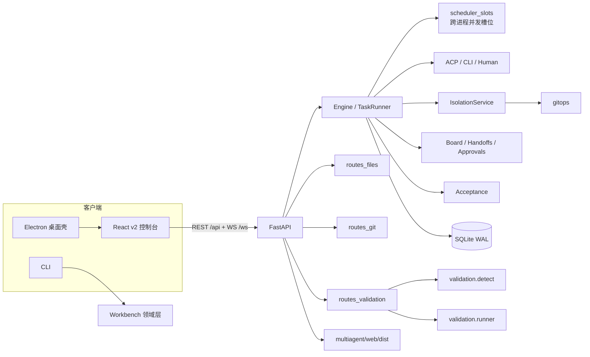
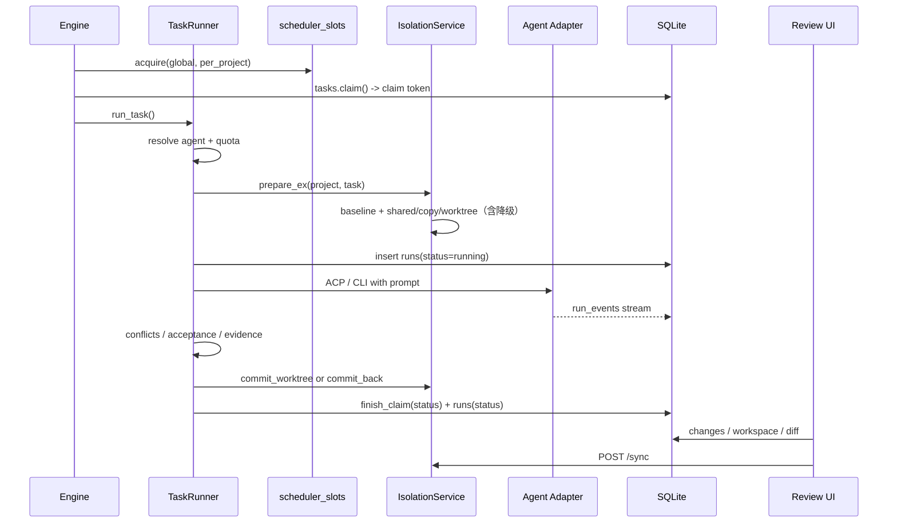

# MultiAgent v2 架构

本文对应仓库当前的 v2 实现：`webapp/` React 控制台、`multiagent/api/routes_*.py` 新增路由、
`multiagent/gitops/`、`multiagent/validation/` 与 worktree 隔离。旧版分层、领域模型和
CLI 字段说明仍保留在 [ARCHITECTURE.md](ARCHITECTURE.md) 与 [USAGE.md](USAGE.md)。

## 1. 全景



核心边界：

- **前端不直接碰文件系统**，所有项目文件、diff、验证都走 REST；
- **Agent 不直接改项目根目录**，除 `shared` 模式外都在 baseline 之上的副本/worktree 中执行；
- **成功由证据判定**，不是由 Agent 的文本结论判定；
- **同步是显式动作**，失败、取消、冲突、漂移都不会自动覆盖工作区。

## 2. 前端架构

### 2.1 模块地图

| 路径 | 职责 |
| --- | --- |
| `webapp/src/main.tsx` | 入口，挂载 React、QueryClient、Toast Provider |
| `webapp/src/app/App.tsx` | 应用外壳、主题、视图分发、全局 Escape、WebSocket/查询装配 |
| `webapp/src/app/TopBar.tsx` | 项目切换、搜索、刷新、开始/停止调度、新任务、设置 |
| `webapp/src/app/Sidebar.tsx` | 九个导航视图、任务/审阅计数、Agent 迷你列表 |
| `webapp/src/app/StatusBar.tsx` | WS 连接、调度状态、Agent 可用数、运行/排队数、Git 分支、根路径 |
| `webapp/src/app/CommandPalette.tsx` | Ctrl/Cmd+K 命令面板：导航、新建任务、开始/停止、切项目、打开任务 |
| `webapp/src/app/store.ts` | Zustand UI 状态与持久化 |
| `webapp/src/app/queries.ts` | React Query hooks、轮询、WebSocket 订阅、项目级 mutation |
| `webapp/src/api/client.ts` | fetch 封装、token 读取、`ApiError`、查询键、WS URL |
| `webapp/src/api/types.ts` | 与后端响应对应的 TypeScript 类型 |
| `webapp/src/features/overview/` | 概览：统计、当前运行、需要处理、队列、Agent、最近活动 |
| `webapp/src/features/tasks/` | 任务看板/列表、筛选、批量操作、新建任务对话框 |
| `webapp/src/features/task/` | 任务详情与五个标签页：概览 / 改动 / 活动 / 日志 / 上下文 |
| `webapp/src/features/runs/` | 运行记录表、汇总、右侧详情、Prompt/stdout/stderr |
| `webapp/src/features/files/` | 只读文件树、内容搜索、文本预览 |
| `webapp/src/features/review/` | 审阅队列、文件 rail、统一 diff、同步确认 |
| `webapp/src/features/memory/` | 共享黑板、交接说明、人工确认、版本快照 |
| `webapp/src/features/agents/` | Agent 编队、握手检测、配置入口 |
| `webapp/src/features/settings/` | 项目、外观、并发与策略、Agent 配置、数据 |
| `webapp/src/features/onboarding/` | 无项目时的打开/新建工作区引导 |
| `webapp/src/ui/` | Button/Input/Dialog/Drawer/Popover/Toast 等无样式库原语 |
| `webapp/src/lib/` | 时间/字节/状态格式化、快捷键 hook |
| `webapp/src/styles/` | tokens、base、layout、components、features 分层 CSS |

没有路由库。视图由 `useUi.view` 决定；任务详情是 `tasks` 视图内的 `taskId` 状态，
不是独立 URL。

### 2.2 状态与查询层

**UI 状态（Zustand）**：`webapp/src/app/store.ts`，持久化键 `multiagent.ui.v2`。

| 字段 | 用途 | 是否持久化 |
| --- | --- | --- |
| `projectId` | 当前项目 | 是 |
| `view` | 当前视图（overview/tasks/runs/files/review/memory/agents/settings） | 是 |
| `theme` | light/dark/system | 是 |
| `sidebarCollapsed` | 侧栏折叠 | 是 |
| `taskId` / `taskTab` | 当前任务与标签页 | 否 |
| `commandOpen` / `newTaskOpen` | 命令面板/新建任务对话框 | 否 |

**服务端状态（React Query）**：`webapp/src/app/queries.ts`。

| 查询键 | 接口 | 刷新策略 |
| --- | --- | --- |
| `["projects"]` | `GET /api/projects` | 手动/失效刷新 |
| `["dashboard", pid]` | `GET /api/projects/{pid}/dashboard` | 15 秒 + 窗口聚焦 |
| `["task", tid]` | `GET /api/tasks/{tid}` | 运行中 3 秒，否则 15 秒 |
| `["agents", "detail"]` | `GET /api/agents/detail` | 30 秒 |
| `["git", pid]` | `GET /api/projects/{pid}/git` | 手动/失效刷新 |
| `["worktree", tid]` | `GET /api/tasks/{tid}/worktree` | 手动/失效刷新（当前 UI 未使用） |

功能内查询（审阅、记忆、文件、运行）使用各自前缀，例如 `["review","changes",tid]`、
`["memory",...]`、`["files",pid,path]`、`["runs",pid]`。审阅页对 `/changes`、`/workspace`、
`/diff` 分别限制 4 / 2 / 3 并发，避免一次打开大量任务时压垮后端。

**WebSocket**：`webapp/src/app/queries.ts` 的 `useLiveProject` 连接
`/ws?project=<pid>`，token 通过 `Sec-WebSocket-Protocol:
multiagent.token.<base64url(token)>` 传递；服务端回显选中的子协议。URL 不再包含 token，
旧客户端仍可用 `?token=`。接收：

- `stream.snapshot` / `stream.event`：实时事件，前端最多保留最近 600 条；
- `events` / `progress` / `run_status`：触发 dashboard 失效刷新；
- 断线后按 500ms、1s、2s … 退避重连，上限 8 秒。

**API 客户端**：token 依次读取 `?token=`、`localStorage.multiagent_token`、
`localStorage.multiagent.token`；有值则加 `Authorization: Bearer`，WebSocket 握手则用
`multiagent.token.<base64url>` 子协议。非 2xx 解析 `detail` / `error` 并抛 `ApiError`；
204 返回 `undefined`；非 JSON 返回文本。

### 2.3 设计系统

`webapp/src/styles/tokens.css` 定义两套主题，组件只使用变量，不写死颜色：

| 类别 | 变量 |
| --- | --- |
| 表面 | `--bg`、`--bg-subtle`、`--surface`、`--surface-raised`、`--surface-sunken`、`--sidebar`、`--overlay` |
| 文字 | `--text`、`--text-secondary`、`--text-muted`、`--text-faint`、`--text-inverse` |
| 线条 | `--border`、`--border-strong`、`--border-faint` |
| 主色 | `--accent`、`--accent-hover`、`--accent-active`、`--accent-soft`、`--accent-text`、`--focus-ring` |
| 语义 | `--success`、`--warning`、`--danger`、`--info` 及各自的 `-soft` / `-text` |
| 字体 | `--font-sans`、`--font-mono`、`--fs-xs` … `--fs-2xl` |
| 几何 | `--r-xs` … `--r-full`、`--shadow-xs` … `--shadow-lg`、`--sidebar-w`、`--inspector-w`、`--topbar-h`、`--statusbar-h` |
| 动效 | `--ease`、`--dur-fast`、`--dur` |

深色主题通过 `:root[data-theme="dark"]` 覆盖同一组变量。基础层是暖中性纸面风格，
状态色只用于状态，不做装饰。没有引入组件库；`ui/primitives.tsx` 提供 Button、Input、
Select、Textarea、Badge、Stat、Panel、EmptyState、Segmented、Kbd 等原语。

### 2.4 视图与任务详情

| 视图 | 关键内容 |
| --- | --- |
| 概览 | 项目标题/路径/Git 分支、任务总数/运行中/需要处理/完成率、当前运行、需要处理、队列、Agent、最近活动 |
| 任务 | 五列看板（待执行 / 执行中 / 待人工 / 成功 / 失败·阻塞）或列表；搜索、Agent/类型/状态筛选、排序、批量运行/重试/取消 |
| 运行 | 运行次数/成功率/总耗时/总 Token 汇总；状态/Agent/任务/尝试/Token/成本/退出码等列；右侧详情 |
| 文件 | 只读文件树、面包屑、文件名/内容搜索、行号预览、换行开关、复制、外部打开 |
| 审阅 | 待审阅 / 已同步 / 失败分组；任务列表、文件列表、统一 diff、同步确认 |
| 记忆 | 共享黑板、交接说明、人工确认、版本快照 |
| Agent | 编队卡片、协议/角色/额度、握手检测、配置入口 |
| 设置 | 项目、外观、并发与策略、Agent 配置、数据 |

任务详情有五个标签：概览、改动、活动、日志、上下文。主操作按状态切换：运行 / 取消 /
验收并合并（Git 任务）/ 验收并同步（copy/shared）/ 重试 / 同步到工作区 / 再次运行；
更多菜单提供仅验收、人工接手、回滚改动、跳过、删除、打开工作目录、复制 ID/标题。

## 3. 后端新增

### 3.1 `multiagent/gitops/`

`gitops/service.py` 把 Git 操作收敛到一层，所有函数对「不是仓库」保持 best-effort；
只有显式 worktree 操作会抛 `GitError`。

| 函数 | 行为 |
| --- | --- |
| `is_repo(root)` | `git rev-parse --is-inside-work-tree` |
| `branch_for_task(task_id, title)` | 生成 `ma/<task-id 尾段>-<slug>` 分支名 |
| `repo_status(root)` | 返回 `is_repo`、`root`、`branch`、`head`、`dirty`、`detached`、`ahead`、`behind`、`remote` |
| `dirty_paths(root)` | `git status --porcelain` 中的用户可见未提交路径；忽略 ignored 文件，并显式排除 `.multiagent/` 控制面 |
| `create_worktree(root, workdir, ...)` | 先 `worktree prune`，清理旧目录，再 `git worktree add -B <branch> <workdir> <base_ref>` |
| `remove_worktree(root, workdir, ...)` | `worktree remove --force` + `prune`，可选删分支；只删目录时分支与提交保留 |
| `delete_worktree_branch(root, branch)` | `git branch -D` 强删任务分支；拒绝当前基线分支由路由层先做 409 |
| `worktree_info(root, workdir, ...)` | 判断 `worktree` / `copy`，返回 branch、head、dirty、pending_files |
| `diff_summary(root, workdir)` | `git diff --numstat HEAD` + 未跟踪文件；返回 files/additions/deletions/binary |
| `commit_worktree(workdir, message)` | `git add -A`（pathspec 显式排除 `.multiagent`）后创建真实 commit；无改动返回 `sha=None` |
| `merge_worktree_branch(root, branch, message, require_clean=True)` | `git merge --no-ff`；`require_clean=true` 时先查 `dirty_paths`，脏树返回 `blocked=True/reason=dirty_worktree/dirty_files`，冲突时 `merge --abort` 并返回冲突文件。Runner 在验收通过后按 `policy.git.auto_merge` 决定是否调用：默认 `false`（先审后合，只提交 `ma/...` 分支），显式 `true` 才自动合并；`POST /api/tasks/{tid}/merge` 也可手动触发 |
| `merge_status(git_meta)` | 把 `task.result.git.merge` 归纳为 `None` / `not_merged` / `merged` / `conflict` / `blocked` / `discarded` / `auto_merge_disabled` |

分支提交只包含交付物；`.multiagent/`（handoff、context 等运行时控制面）被显式排除，
即使项目没有 `.gitignore` 也不会进入 commit。`dirty_paths` 同样忽略控制面，避免每个
导入项目因 `.multiagent/project.json` 被误判为脏树。

### 3.2 `multiagent/api/routes_files.py`

只读项目文件 API，供 v2 文件视图使用：

| 接口 | 行为 |
| --- | --- |
| `GET /api/projects/{pid}/files?path=` | 列目录；目录优先、名称排序；返回 `path/name/dir/size/mtime` |
| `GET /api/projects/{pid}/file?path=` | 读文本文件；前 8KB 含 NUL 判为二进制；最多读 2MiB |
| `GET /api/projects/{pid}/search?q=&limit=` | 内容搜索；最多 200 条匹配、1500 个文件、8 秒；单行截 400 字符 |

边界：

- 单目录最多 2000 项，超出返回 `truncated: true`；
- 搜索跳过大于 512KB 的文件；
- 使用 `effective_excludes`（`.multiagentignore` + 工作区 excludes）过滤；
- `resolve_workspace_path` 拒绝路径逃逸，越界返回 400；
- 不提供写入、重命名、删除接口。

### 3.3 `multiagent/api/routes_git.py`

| 接口 | 行为 |
| --- | --- |
| `GET /api/projects/{pid}/git` | 仓库状态；非仓库返回 `{"is_repo": false}` |
| `GET /api/tasks/{tid}/worktree` | 任务工作副本信息；返回 `mode`、`path`、`branch`、`head`、`dirty`、`pending_files`，并新增 `git`（原始 `result.git`）与 `merge_status` |
| `GET /api/tasks/{tid}/git-diff` | `git diff --numstat HEAD` + 未跟踪文件摘要；无工作副本返回 `available: false` |
| `GET /api/tasks/{tid}/git-diff/file?path=` | 单文件 `git diff HEAD -- path`；未跟踪文件合成新增 diff |
| `POST /api/tasks/{tid}/merge` | worktree 任务执行真实 `git merge --no-ff`；成功 200，脏树/冲突/失败返回结构化 409。非 Git / copy 模式退化为文件级回收 |
| `GET /api/tasks/{tid}/commit` | 返回任务分支的 commit、base、branch 与文件清单 |
| `POST /api/tasks/{tid}/discard-worktree` | 删除任务 worktree；body 可选 `{"delete_branch": true}` 同时删除 `ma/...` 分支 |

`/merge` 的语义：

- Git + worktree：先落盘未提交改动，再合并 `ma/...` 分支到当前基线分支；
- 成功 200：`merged=true`、`conflict=false`、`blocked=false`、`sha`、`branch`、`base`、
  `files`、`count`，并写回 `task.result.git.merge`（`source=manual`）；
- 脏树 409：`merged=false`、`blocked=true`、`conflict=false`、`reason="dirty_worktree"`、
  `dirty_files=[...]`、`branch`、`base`、`sha=null`、`files=[]`、`message`、`error`；
  不会进入 merge 状态，用户改动不被破坏；
- 冲突 409：`merged=false`、`blocked=false`、`conflict=true`、`reason="conflict"`、
  `files=[冲突文件]`、`branch`、`base`、`sha=null`、`message`、`error`；已执行
  `git merge --abort`，仓库保持干净；
- 其它失败 409：`reason="merge_failed"`（或底层原因），并带 `error`；
- `git.require_clean_tree=false` 可跳过脏树检查；默认开启（`true`）；
- 非 Git / copy：调用 `commit_back(..., only_in_scope=False)` 逐文件回收，仍拒绝路径逃逸、
  excludes 与工作区漂移，返回 `committed` / `count`；
- 事件：`task.git.committed`、`task.git.merged`、`task.git.merge.conflict`、
  `task.git.merge.blocked`、`task.git.merge.skipped`、`task.git.merge.failed`。

`/discard-worktree` 的语义：

- body 为空或 `delete_branch=false`：只删 worktree 目录，任务分支保留；
- `delete_branch=true`：先移除 worktree，再强删任务分支；worktree 不存在但分支存在时
  也可删除；当前基线分支返回 409；
- 分支删除后写回 `result.git.merge.discarded=true` / `reason="discarded"`，刷新后 UI
  显示「任务分支已放弃」，不再提供必然 409 的合并入口；
- 响应字段：`discarded`（是否删了 worktree）、`branch_deleted`、`branch`、`message`。

Runner 在 worktree 任务验收通过后，**默认不自动合并**：`policy.git.auto_merge=false`
（先审后合），只把交付物提交到 `ma/<task>` 任务分支；下游任务必须先人工合并才能看到
上游产出。需要 DAG 连续交付的项目显式设为 `true`，才执行 `git merge --no-ff` 回基线。
`auto_merge=false` 时写入 `git.merge = {merged:false, skipped:true,
reason:"auto_merge_disabled"}`，不会伪装成已合并。

默认先审后合；需要 DAG 连续交付时改为：

```json
{
  "git": {
    "auto_merge": true,
    "require_clean_tree": true,
    "keep_worktree": true
  }
}
```

`require_clean_tree=true` 阻断脏基线合并，`keep_worktree=true` 保留工作副本便于复审；
两项建议在开启自动合并时也保持不变。

worktree 基线有一个关键细节：`IsolationService.prepare_ex()` 在创建 worktree 后，从
**worktree 本身**复制 baseline（只复制一次），而不是从项目根目录复制。否则 Windows
的 CRLF 转换和未跟踪文件会让每个文本文件都被判成“被修改”，把正常任务误判为越权。

### 3.4 `multiagent/api/routes_validation.py`

| 接口 | 行为 |
| --- | --- |
| `GET /api/projects/{pid}/inspect` | 探测项目技术栈，返回 profile；不执行任何检查 |
| `POST /api/tasks/{tid}/validate` | 在任务工作副本（或 shared 的项目根目录）运行检查；可传 `checks`、`timeout_sec` |
| `GET /api/tasks/{tid}/validation` | 返回最近一份验证报告 |

执行位置：

- `shared`：项目根目录；
- `copy` / `worktree`：任务的 `work/`；工作副本尚未创建时返回 409，要求先运行任务。

探测与命令生成（`multiagent/validation/detect.py`）：

- 识别 Node/TypeScript、Python、Rust、Go、Java（Maven/Gradle）、PHP、Ruby、Make；
- 读取 `package.json` scripts、`pyproject.toml` / pytest、`Cargo.toml`、`go.mod`、Makefile 目标；
- 生成 `lint` / `typecheck` / `test` / `build` 检查，返回 `commands`、`recommended`、`blocked`、
  `default_timeout_sec`、`ignored_dirs`、`files_scanned`；
- 包含安装命令的脚本不会执行，而是进入 `blocked` 列表。

执行器（`multiagent/validation/runner.py`）：

- 全部 `shell=False`；Windows `.cmd` / `.bat` 通过显式 `cmd.exe` 包装并校验 shell 元字符；
- 环境变量使用 allowlist，不继承调用者的全部环境；
- 输出最多保留 200KB，管道持续排空；
- 硬超时 + 进程树回收；超时范围 1..3600 秒，默认 600 秒；
- `checks` 最多 32 项；命令找不到时标记 skipped，不失败；
- 报告写入 `<runtime>/<project>/tasks/<task>/validation/<report_id>.json`。

`ok` 的判定：至少一个通过，且没有失败、超时、取消；skipped 不计失败。没有可运行检查时
`ok=false`、`empty=true`，并返回说明。

### 3.5 工作副本同步：`multiagent/api/taskworkspace.py`

`GET /api/tasks/{tid}/workspace` 返回两个不同含义的计数：

- `pending`：`baseline` vs `workdir` 的差异，是 `commit_back` 的输入；同步后仍可能非 0。
- `unsynced`：`workdir` vs 项目根目录的差异，是 UI 的「待同步 N」；同步后归零。

此外还返回 `git`（原始 `task.result.git`）和 `merge_status`。worktree 任务验收后默认
已 `git merge` 回基线，此时字节差异可能只是 CRLF/构建产物；只要
`merge_status=merged`，`unsynced` 强制归零、`can_sync=false`，避免审阅页继续显示
「待同步」。`merge_status=discarded` 同样禁止同步并归零。这样审阅页能据实显示
「已合并 / 冲突 / 已放弃」，而不是把所有 Git 任务都当成文件同步。

`POST /api/tasks/{tid}/sync` 的规则：

- `dry_run=true` 只返回 `planned`，不落盘；
- `read_only` 拒绝同步；`shared` 返回 `already_shared`；
- 只回收 `write_scope` 内、非保护路径、非 excludes、无并发冲突、无工作区漂移的文件；
- 不改变任务状态；running 也允许同步，但 UI 会提示结果可能不完整；
- 返回 `committed`、`skipped`、`skipped_details`、`conflicts`、`out_of_scope`、`already_synced`。

### 3.6 静态资源与旧版回退

`_register_static` 在 `multiagent/web/` 存在时：

- `/`：优先返回 `multiagent/web/dist/index.html`；构建产物缺失时降级返回旧页面，
  这是最小安装兜底；
- `/legacy`：默认 404；仅当 `MULTIAGENT_UI=legacy` 时返回旧版 `multiagent/web/index.html`；
- `/static/index.html`：精确路由先于 `StaticFiles` 注册，默认 404；同样只由
  `MULTIAGENT_UI=legacy` 解锁；
- `/static`：挂载 `multiagent/web/`，v2 构建资源路径为 `/static/dist/`。

Vite 的 `base` 是 `/static/dist/`，构建输出是 `multiagent/web/dist/`，因此 v2 的资源
路径与后端的 `/static` 挂载一致。旧版入口不再作为并列入口默认暴露。

### 3.7 进程审计：`multiagent/agents/process_audit.py`

Agent 可能在任务 `workdir` 里拉起 dev server 并留下监听进程。Runner 在调用前后各拍一次
监听 TCP 快照，只处理新增 pid，并写入 `task.result.processes`：

- 归属判定：command / exe_path 中出现规范化后的 workdir，或 prober 给出的 cwd 位于
  workdir 之下；
- 只有 `owned=true` 且 `reap=true`（`processes.reap_orphans=true`）才终止；
- 判断不了归属的只写 `warnings`，永不误杀；pid<=4、当前进程、父进程、调用前已存在的
  pid 永不触碰；
- `processes.audit_enabled=false` 时完全跳过；计划超时为 1..4 秒（低于
  `processes.min_timeout_sec`，默认 0）默认所有任务都审计；正数可跳过极短任务
  Windows 进程元数据查询破坏硬超时语义；超时 0（不限时）仍审计；
- prober/killer 可注入，测试不依赖真实端口；任何异常折算为 `supported=false` + warning，
  不会拖垮任务；
- 审计是旁路能力，**不保证**清理所有残留进程，端口仍占用时按 warning 人工检查。
- Windows 的 `finish` 阶段额外执行 `Get-NetTCPConnection -State Listen`（CIM）补齐
  netstat 漏报；`finish` 异步执行，不阻塞 `run_task` 返回；CIM 失败只降级为 warning，
  不改变 netstat 已有结果的判定与回收能力。

### 3.8 计划创建路径扫描：`multiagent/tasks/planner.py`

`apply_plan` 在写库前扫描项目根目录，把「预期路径写错」的精确路径回填为实际产物：

- 只处理 `outputs` 和路径型验收条件（`file_exists` / `file_nonempty` 等）中的精确路径；
  含 glob 元字符的路径不重写；
- 目标已存在则保持原样；
- 目标不存在且 basename 在项目内只有唯一候选：回填为候选的相对 POSIX 路径，并同步
  `outputs` 与验收条件；未显式写 `write_scope` 时按新 outputs 重新推导；
- 多候选 / 无候选：保留原路径并写 warning，不阻断创建；
- 绝对路径、`..` 和项目外候选一律跳过并告警；
- 结果写入 `result.acceptance_path_scan`：`autofixes=[{from,to,where}]`、
  `warnings=[{path,message,candidates}]`；
- 回填只修正路径，不放宽阈值；最终是否通过仍由 Agent 的真实产物决定。

## 4. 执行生命周期

阶段顺序：`claim → prepare/worktree → ACP/CLI stream → evidence → acceptance → commit/merge → review`。



1. **调度与认领**：`Engine.run_project` 按 `concurrency.global` / `concurrency.per_project`
   抢 `scheduler_slots` 槽位；跨进程也生效。任务通过 `tasks.claim()` 原子认领，写入
   `claim_id` / `claim_owner` / `claimed_at` 并获得 token。
2. **执行者与额度**：显式 `agent_id` 优先，否则走路由；human 走等待人工路径；额度检查
   失败时任务进入 `blocked` 并生成 `quota` 审批。
3. **隔离准备**：`IsolationService.prepare_ex()` 先决定实际模式，再生成 `baseline/`
   （copy 路径从项目根目录复制；worktree 成功路径从新建的 worktree 复制一次），按模式
   生成 `work/`；返回 `requested_mode` / `mode` / `workdir` /
   `degraded` / `degrade_code` / `degrade_reason`，调用方写入
   `task.result.isolation`，UI 因此能看到「请求 worktree，实际 copy」的原因：
   - `shared`：直接使用项目根目录；修改型任务（code/doc/data/ppt/diagrams/web）在空
     `write_scope` 时安全兜底为 `copy`（`degrade_code=unscoped_shared`）；
   - `copy`：复制 baseline 到独立副本；
   - `worktree`：Git 仓库用 `git worktree add`；非 Git 仓库退化为 `copy`
     （`not_git_repo`）；工作区有未提交改动退化为 `copy`（`dirty_workspace`，
     `.multiagent/` 不算脏）；`worktree add` 失败退化为 `copy`（`worktree_failed`）；
   - `read_only`：强制 `copy`，属于策略行为，不标记为降级，绝不触碰项目根目录。
   - **P1-6 单次复制**：worktree 成功路径只从新建的 worktree 复制一次 baseline，
     不再先 `root→baseline`；否则 Windows CRLF 转换和未跟踪文件会把每个文本文件判成
     「被修改」，把构建产物判成「删除」。copy 路径才执行 `root→baseline→work`。
4. **上下文与运行**：注入任务简报、前置交接、决策/问题/待办、项目记忆（按
   `context_budget_chars` 截断），写 `context.json` 与 `prompt.txt`，然后插入 `runs` 行，
   通过 ACP stdio 或 CLI 子进程执行。Agent 事件写入 `run_events` 并推送到 WebSocket。
5. **证据**：每次运行目录保留 `context.json`、`prompt.txt`、`stdout.txt`、`stderr.txt`、
   `transcript.json`；Agent 可写 `work/.multiagent/handoff.json`。产物登记到 `artifacts`，
   文件改动登记到 `file_changes`，before/after 内容按 sha256 存入 blob 仓库。
6. **验收与提交**：
   - 先在 `work/` 上计算改动、检测并发冲突、把越权改动还原到 baseline；
   - 验收条件在 `work/` 上执行；
   - `worktree` 任务在成功时创建任务分支 commit（排除 `.multiagent/`），并按
     `git.auto_merge`（默认 `false`，先审后合）决定是否 `git merge --no-ff` 回基线；
     合并前按 `git.require_clean_tree` 检查脏树，脏树/冲突会把任务转为 `blocked`
     并保留现场；
     成功后按 `git.keep_worktree` 决定是否回收 worktree 目录（分支永不删除）；
   - `copy` 任务在成功时 `commit_back` 到项目根目录；
   - 取消、超时、冲突、claim 失效、验收失败时不自动回收；
   - 声明了 outputs 的非 worktree 任务，成功前还会检查项目根目录是否真的有这些产物。
7. **状态落库**：`finish_claim` 只在 token 仍有效时写入最终状态；如果任务在运行期间被
   取消/接管，结果只留档，不回写工作区。
8. **审阅**：Review UI 读取 `file_changes`、`workspace`、`diff`，按 `merge_status`
   决定动作：`merged` 直接归入「已合并 / 已同步」；`auto_merge_disabled`/`not_merged`
   调用 `/merge` 做 Git 合并；`conflict`/`blocked` 展示合并问题；只有 copy/shared
   （`merge_status=null`）才调用 `/sync` 做文件级回收。之后任务仍在 `success`，但
   `unsynced` 归零，分组变为「已合并 / 已同步」。

## 5. 数据模型

SQLite（WAL）表清单，定义在 `multiagent/db.py`：

| 表 | 作用 |
| --- | --- |
| `meta` | 数据库元信息 |
| `projects` | 项目/工作区登记、根路径、导入来源、只读标记、项目配置 |
| `snapshots` | 版本快照清单、存储路径、文件数/字节数 |
| `tasks` | 任务主体、状态、隔离方式、写范围、验收、产物、workdir、claim 字段 |
| `task_edges` | 任务依赖边与依赖模式（success/soft/any/always） |
| `task_states` | 任务状态迁移历史与原因 |
| `runs` | 每次 Agent 调用：状态、退出码、耗时、Token、成本、证据路径、心跳 |
| `run_events` | Agent 实时事件流，支持跨进程回放 |
| `board_entries` | 共享黑板条目：scope/type/status/版本 |
| `board_versions` | 黑板条目版本历史 |
| `events` | 追加事件与哈希链（`prev_hash` / `hash`） |
| `handoffs` | 结构化交接：做了什么、没做什么、遗留问题、下一步 |
| `artifacts` | 输入/输出产物、路径、sha256、大小、片段 |
| `file_changes` | 文件改动日志：create/modify/delete、before/after hash、scope/conflict |
| `approvals` | 人工确认队列：kind/risk/status/resolution |
| `leases` | 资源租约，避免同一资源被并发占用 |
| `agent_usage` | 每 Agent 的调用次数、时长、成本、Token |
| `runtime_sessions` | 进程身份与心跳，用于崩溃恢复的存活判定 |
| `schema_migrations` | 版本化迁移记录与迁移前备份 |
| `scheduler_slots` | 跨进程调度槽位（global / per_project） |

`runs.status` 的取值：`running`、`success`、`blocked`、`waiting`、`cancelled`、
`interrupted`、`failed`。任务最终状态到 run 状态的映射在 `TaskRunner` 收尾逻辑中完成。

## 6. 失败分类

### 6.1 任务状态

| 状态 | 含义 | 典型触发 | 人工动作 |
| --- | --- | --- | --- |
| `pending` | 待执行 | 新建任务、回滚后重排队 | 运行 / 等待调度 |
| `running` | 执行中 | 已被认领，Agent 在跑 | 取消 |
| `success` | 成功 | 退出成功 + 验收通过 + 产物存在 + 无冲突 + claim 有效 | 审阅、同步 |
| `failed` | 失败 | Agent 错误、退出码非 0、验收失败、缺失产物 | 看日志/改动，重试或人工接手 |
| `blocked` | 阻塞 | 额度超限、并发冲突、工作区漂移、验收需人工、worktree 提交失败、工作区缺产物 | 处理审批/冲突，重试或手动同步 |
| `waiting` | 等待人工执行 | human 执行者接手 | 人工产出后 Git 任务「验收并合并」，copy/shared「验收并同步」 |
| `cancelled` | 已取消 | 用户取消，Agent 被终止 | 现场保留，可重试 |
| `skipped` | 已跳过 | 人工跳过 | 可重试复活 |
| `interrupted` | 中断 | 进程崩溃/陈旧心跳，恢复时标记 | `recover` 后续跑 |

### 6.2 运行状态

| run 状态 | 含义 |
| --- | --- |
| `running` | Agent 调用进行中 |
| `success` | 调用完成，任务最终为 success |
| `blocked` | 调用完成但任务 blocked |
| `waiting` | 任务等待人工 |
| `cancelled` | 调用被取消 |
| `interrupted` | 调用被恢复流程标记中断 |
| `failed` | 其余失败 |

### 6.3 审批类型

| kind | 触发 |
| --- | --- |
| `dangerous_op` | 危险命令/删除/覆盖产物等 |
| `conflict` | 并发改同一文件、工作区漂移、回收失败 |
| `acceptance_failed` | 验收条件不通过 |
| `quota` | Agent 调用次数/时长/成本超限 |
| `manual_confirm` | 验收需要人工确认 |
| `general` | 其他人工确认 |

### 6.4 常见阻塞原因

- **额度超限**：`quota.blocked`，任务 blocked，生成 quota 审批；
- **并发冲突**：多个运行中任务改同一文件，冲突文件被归档并还原，任务 blocked；
- **工作区漂移**：任务执行期间目标文件被外部修改，`commit_back` 拒绝覆盖并生成 conflict 审批；
- **验收失败**：条件不通过，生成 acceptance_failed 审批，任务 failed；
- **基线脏树**：`git.require_clean_tree=true` 且 `dirty_paths` 非空，合并被阻止，
  任务 blocked，`result.git.merge.reason=dirty_worktree` 并带 `dirty_files`；
- **合并冲突**：任务分支与基线冲突，`git merge --abort` 后返回 409，任务 blocked，
  UI 显示冲突文件，需人工解决后重试合并；
- **工作区缺产物**：副本内验收通过但项目根目录没有声明的 outputs，任务 blocked；
- **worktree 提交失败**：Git 提交异常，任务 blocked，改动保留在分支工作副本；
- **claim 失效**：任务被取消/接管，结果不回写，事件标记 `task.claim_lost`；
- **执行器异常**：适配器抛错，任务 failed，run 保留错误与证据。

## 7. 已知边界

以下行为按当前代码记录，避免文档把「已实现」写成「已接线」：

- `POST /api/tasks/{tid}/validate` 没有 v2 UI 入口；验证目前通过 API 使用。
- v2 审阅页和任务详情使用 `merge_status` 决定「合并到基线」还是文件同步；
  worktree 任务走 `POST /merge`，copy/shared 才走 `POST /sync`。两者语义不同，不能
  互相替代。
- `GET /api/tasks/{tid}/git-diff`、`GET /api/tasks/{tid}/git-diff/file` 当前没有 v2 UI
  入口；审阅页使用 `/changes` + `/diff`。
- `GET /api/tasks/{tid}/worktree` 的查询 hook 已存在，但当前 UI 主要读取
  `/workspace` 的 `git` / `merge_status`；任务详情展示隔离模式与工作目录。
- `POST /api/tasks/{tid}/discard-worktree` 已接入任务详情和审阅页的「放弃任务分支」，
  默认保留分支，只有显式 `delete_branch=true` 才删除。
- `POST /api/projects/{pid}/decompose/preview` / `apply` 提供大型项目九阶段 DAG，
  但 v2 新建任务对话框只接入了「调研 → 初稿 → 审阅」三步计划。
- 计划创建会扫描路径（见 3.8），但只处理精确路径的唯一候选回填；glob 不重写，
  多候选/无候选只告警。计划中的 `outputs`、`acceptance`、`acceptance_ref` 仍建议显式填写。
- `git.require_clean_tree=false` 允许脏基线合并，但会削弱审计边界；默认保持开启。
- 默认 `git.auto_merge=false`（先审后合）：验收通过只提交 `ma/<task>` 分支，DAG 下游
  任务必须等人工合并后才能看到产出；需要连续交付的项目显式设为 `true`。

## 8. 相关文档

- [USAGE-V2.md](USAGE-V2.md)：逐视图操作、快捷键、审阅/同步、审批、验证
- [DEFECTS-V2.md](DEFECTS-V2.md)：P0-1..P2-18 缺陷状态、改动文件与验证命令
- [ARCHITECTURE.md](ARCHITECTURE.md)：v1 分层与领域模型
- [OPERATIONS.md](OPERATIONS.md)：备份、恢复、清理、体检
- [VERIFICATION.md](VERIFICATION.md)：测试分层与验证边界
